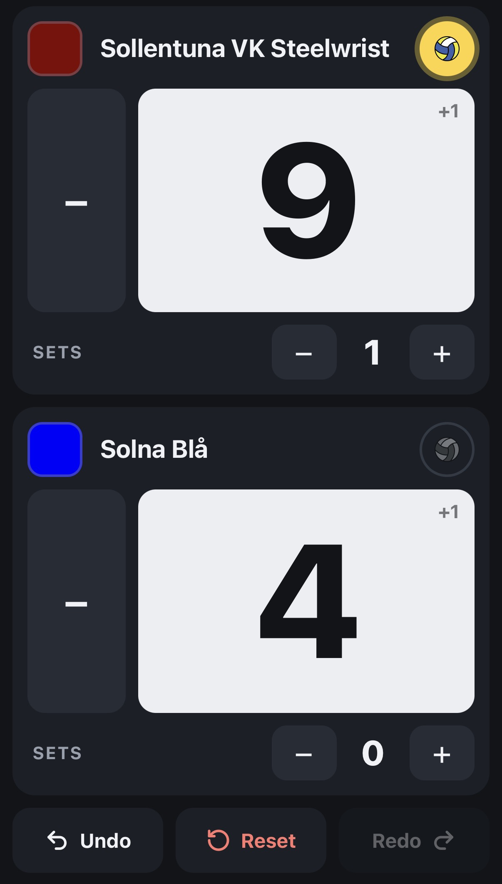

# Scoreboard Controller and Overlay

A multi-user web-based scoreboard application designed for volleyball games. It provides a controller interface for updating scores, automated scraping from Profixio match pages, stats generation, and an overlay that can be used in streaming software.



## Features

- **Multi-user support**: Each user has isolated data and can run independent scrapers
- **Automated scraping**: Fetch live scores from Profixio match URLs, including `https://www.profixio.com/app/lx/match/32678592` and legacy competition URLs with `?expandmatch=<matchId>`
- **Manual control**: Real-time score updates with undo/redo functionality
- **Stats generation**: Automatic player statistics from match data
- **Customizable**: Team names, jersey colors, and overlay themes
- **Streaming overlay**: Simple overlay for OBS/vMix integration
- **Secure**: Session-based authentication with rate limiting

## Installation

### Prerequisites

Install required Python packages using the same interpreter and environment
that will run `server.py`. If you use a virtual environment, activate it first.

```bash
python3 -m pip install flask waitress requests beautifulsoup4 lxml werkzeug
```

**BeautifulSoup4 is required for server startup**, including manual-only setups.
The server imports `score_status.py`, which uses it to read the saved scoreboard
for the JSON and plain-text status endpoints. Its package name is
`beautifulsoup4`, but its Python import name is `bs4`. The current `scraper.py`
does not import BeautifulSoup.

Python must provide `hashlib.pbkdf2_hmac` for password generation and login.
On Python 3.12 and later, this requires working OpenSSL support (see
[Python's hashlib documentation](https://docs.python.org/3/library/hashlib.html#hashlib.pbkdf2_hmac)).

### Setup

1. **Clone the repository**:
   ```bash
   git clone https://github.com/yourusername/scoreboard.git
   cd scoreboard
   ```

2. **Create a user account**:
   ```bash
   # Generate a password hash
   python3 generate_password.py your_password_here
   
   # Copy the output hash
   # Edit users.json (copy from users.json.example)
   ```

3. **Configure users.json**:
   ```json
   {
     "users": {
       "yourusername": {
         "password_hash": "pbkdf2:sha256:1000000$...",
         "token": "your-random-token-here",
         "display_name": "Your Name"
       }
     }
   }
   ```

4. **Set session secret** (production):
   ```bash
   export SCOREBOARD_FLASK_SECRET=$(python3 -c 'import secrets; print(secrets.token_hex(32))')
   ```

5. **Run the server**:
   ```bash
   python3 server.py
   ```

6. **Access the application**:
   - Login: http://localhost:8081/login
   - Control panel: http://localhost:8081/yourusername/control
   - Manual scoreboard: http://localhost:8081/yourusername/scoreboard.html
   - Overlay: http://localhost:8081/yourusername/overlay/

## Troubleshooting

### Server fails with `ModuleNotFoundError: No module named 'bs4'`

BeautifulSoup4 is missing from the Python environment running the server.
Existing installations need this dependency for the new status endpoints,
regardless of whether they use the scraper or Watch integration.

Activate the server's virtual environment, if applicable, then install the
package, verify the import, and restart:

```sh
python3 -m pip install beautifulsoup4
python3 -c 'from bs4 import BeautifulSoup; print("BeautifulSoup OK")'
python3 server.py
```

If a service starts the server with a specific Python executable, use that same
executable in these commands. Installing the package into another Python
environment will not resolve the error.

### Login fails with `hashlib` has no attribute `pbkdf2_hmac`

This means the Python interpreter running Scoreboard lacks the password-hashing
function used by Werkzeug. On Python 3.12+, missing or unloadable OpenSSL support
can cause this. The generated session-secret warning is unrelated.

On Alpine Linux, update Python and its OpenSSL libraries from your configured
repositories as root, then check that password hashing works:

```sh
apk update
apk add --upgrade python3 libcrypto3 libssl3
python3 -c 'import hashlib; hashlib.pbkdf2_hmac("sha256", b"test", b"salt", 1); print("PBKDF2 OK")'
```

If the check prints `PBKDF2 OK`, restart `python3 server.py` and log in using your
existing password. No changes to `users.json` are needed. Scoreboard checks for
this missing function at startup, including when imported by a WSGI server;
the password generator also reports how to repair the runtime.

If the check still fails, run these diagnostics with the same interpreter used
to start the server:

```sh
python3 -c 'import sys, hashlib; print(sys.executable); print(sys.version); print(hashlib.__file__)'
python3 -c 'import _hashlib'
apk policy python3 libcrypto3 libssl3
```

The `_hashlib` import exposes missing libraries or incompatible symbols that
`hashlib` can hide. If packaged files are missing or damaged, reinstall them with
`apk fix python3 libcrypto3 libssl3`, then rerun the check. A custom-built Python
needs to be rebuilt with OpenSSL support or replaced with Alpine's packaged
interpreter. A local file named `hashlib.py` can also shadow the standard library;
the diagnostic path above helps identify that case.

See [Alpine's package-management documentation](https://wiki.alpinelinux.org/wiki/Alpine_Package_Keeper)
for package repair commands. On other systems, repair the corresponding Python
and OpenSSL packages or use a Python build with working OpenSSL support.

## Security

⚠️ **Important**: Read [SECURITY.md](SECURITY.md) before deploying to production.

**Built-in protections**:
- ✅ Rate limiting (5 failed logins per IP per 5 minutes)
- ✅ Password hashing (pbkdf2:sha256)
- ✅ Session-based authentication
- ✅ User data isolation
- ✅ Upload size limits (5MB)
- ✅ Auto-generated session secrets

**For production deployment**:
- Use HTTPS (reverse proxy with nginx/Apache/Caddy)
- Set `SCOREBOARD_FLASK_SECRET` environment variable
- Run behind firewall or VPN
- Keep `users.json` private (already in .gitignore)

### HTTPS via Caddy + Let's Encrypt

[Caddy](https://caddyserver.com) provisions and renews a Let's Encrypt
certificate automatically and reverse-proxies to the Waitress server
unchanged. This is an optional way to provide HTTPS over a real DNS hostname.
Tubeist supports both HTTP and HTTPS for overlays and external status, so an
existing HTTP deployment does not need a reverse proxy for the Watch status page:

```bash
brew install caddy   # or your OS package manager
```

`$(brew --prefix)/etc/Caddyfile` (`/opt/homebrew/etc/Caddyfile` on Apple
Silicon, `/usr/local/etc/Caddyfile` on Intel):
```
{
    http_port 8080
    https_port 8443
}

yourdomain.example.com {
    reverse_proxy localhost:8081
}
```

```bash
brew services start caddy   # runs as a launchd service, survives reboots
```

`http_port`/`https_port` move Caddy's listeners off the privileged 80/443
ports so it doesn't need root. On your router, forward the public ports to
these instead: external **80 → 8080**, external **443 → 8443**, on the LAN
IP of the machine running Caddy. Let's Encrypt and browsers/clients only
ever see the standard public ports 80/443 — the port remap is invisible to
them, handled entirely by the router's NAT.

## External displays and Tubeist Watch

`GET /<username>/api/status` returns a short UTF-8 plain text status, for example:

```text
Sollentuna VK C – Vallentuna VBK B
Sets: 1–2
Points: 14–25
```

After a scraped match ends, the second line is `Final: 1–3` and the points
line is omitted. Formatting and volleyball knowledge belong to this server.
Tubeist and its Watch companion just relay and display the text; other services
can provide a different sport or any other short status with the same contract.

In Tubeist settings, set **Watch companion → External status URL** to the full
HTTP or HTTPS address, including the username and `/api/status` path:

- Existing HTTP server: `http://192.168.1.50:8081/<username>/api/status`
- HTTPS reverse proxy: `https://yourdomain.example.com/<username>/api/status`

Replace the example host, port, and username with yours. Use an address reachable
from the iPhone; `localhost` on the phone does not refer to your NAS. HTTP works
with the existing Waitress server directly, without a certificate or proxy. For
a local server, allow Tubeist's Local Network access when iOS asks. If access was
denied earlier, enable it in iPhone Settings → Privacy & Security → Local Network.
HTTPS is recommended, especially across the internet: HTTP allows the URL and
status text to be read or altered in transit. Do not send private URL tokens or
sensitive status information over HTTP. HTTPS certificates must be trusted by
the iPhone; Tubeist does not bypass certificate checks.

The address must return HTTP 200 with `Content-Type: text/plain; charset=utf-8`,
without redirects. Both protocols use the same text validation and size limits.
Tubeist adds no path or suffix. Clear the setting to disable it. While Tubeist is
active and streaming or recording, it fetches at most once every five seconds
and forwards the latest text to the paired Watch. Swipe to the separate external
status page in the companion app; the existing Live Activity layout is unchanged.
Text becomes marked out of date after 30 seconds without a successful fetch.
This timestamp reflects delivery, not the age of the underlying match data.

Both `/api/status` and the JSON endpoint `/api/score` read `scoreboard.xml`, so
manual updates and scraped scores use the same source as the overlay. No JSON
sidecar is needed. Missing scoreboards return 404; incomplete or unreadable
scoreboards return 503. Successful responses disable HTTP caching. These are
public read endpoints, just like the overlay; do not include private information
in team names. Existing upload authentication still applies to score changes.

`/api/score` returns `home` and `away` objects with `name`, `sets`, and `points`,
plus `matchEnded`. Completed overlays omit point fields, so the API returns zero
for both points and `matchEnded: true`. The manual controller keeps point fields,
so it does not signal match completion.

The text endpoint bounds team names to 80 Unicode code points each and removes
control characters and explicit bidirectional overrides. The response fits the
client limits of 4,096 UTF-8 bytes, 500 characters, and 8 lines. Clients must
render it literally, without interpreting markup, links, or commands.

## Version History

### v2.0.0 (Multi-User) - Current Development
The current version includes multi-user support with enhanced security features.

### v1.2.8 (Single-User) - Stable Release
If you don't need multi-user support, **v1.2.8** is a simpler, stable single-user option.

To use v1.2.8:
```bash
git checkout v1.2.8
# Follow the simpler setup instructions in that version's README
```

**Migrating from v1.2.8 to v2.0.0:**
1. Create `users.json` from `users.json.example` with your username and hashed password
2. Move existing `scoreboard.xml` to `data/<username>/scoreboard.xml`
3. Update any bookmarks or OBS browser sources to include `/<username>/` in the path
4. Remove old `PAGE_PASSWORD` and token-based authentication code

See [CHANGELOG.md](CHANGELOG.md) for detailed changes.

## Usage

- **Control Panel**: Start/stop scraper, generate stats, navigate to manual scoring
- **Manual Scoreboard**: Update scores, team names, and settings from any web browser. The layout is made for a phone: each team has a panel where tapping the large score adds a point (and gives that team the serve), with smaller buttons for corrections and sets, and undo, reset, and redo along the bottom. Portrait stacks the teams; landscape places them side by side.
- **Overlay**: Add to OBS/vMix using the overlay URL - updates automatically. Choose a theme on the Control Panel before copying the link. Modern is the default; `?theme=arena` selects a bottom-centered broadcast bar, `?theme=courtside` selects a compact two-row scoreboard at the top left, `?theme=retro` selects a sports-hall LED board at the top right, `?theme=daylight` selects a light two-row card at the bottom left, and `?theme=legacy` selects the legacy layout. Arena, Courtside, Retro, and Daylight use compact, single-line action highlights. Changing the selector updates the link to copy; paste the new link into your streaming software to switch themes.

## Requirements

- Python 3.7+
- Flask, Waitress, Requests, BeautifulSoup4, lxml, Werkzeug
- Web browser with JavaScript enabled

## Contributing

Feel free to submit issues or pull requests for improvements.


### Jersey colors

The scraper attempts a background lookup from the legacy Profixio match page once per minute. Missing pages, missing colors, and request failures do not stop score polling; previously found colors are retained.

On the Control Panel, enable **Override home color** or **Override away color**, choose a color, and click **Save Colors**. Saved overrides take priority on each score update and persist per user across restarts and future matches. **Use Automatic Colors** clears both overrides. Restart an already-running scraper after upgrading to enable this feature.
